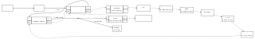

# Ethos Catalog

A collection of neural networks, benchmarks and demos for Arm Ethos NPUs.

The goal of the project is to identify networks that can run on a board using Ethos. 

As consequences:

* This project does not deliver networks quantized with state of the art methods
  * Networks are not made to be reused as they are in a product
  * The user interested in a network should check the accuracy on the full set of test patterns
  * The network may have to be reconverted and quantized with better methods
* This project does not try to optimize pre / post processing when what's available is enough to run the demo on board
* This project does not try to optimize the final CMSIS Stream graph that may contain more data copies than required in a better graph

Once a user has identified a network from this list, we expect that more time 
will be spent by the user on validating the conversion and quantization 
step before using the network in a product.

The demos use CMSIS Stream, whose POSIX and Zephyr runtimes provide a path to
porting them to Linux or Zephyr, including on Cortex-A processors. These ports
have not yet been implemented in this repository.

See the [build and usage guide](documentation/HOWTO.md) for setup instructions
and details on building, running and extending the projects.
Each application keeps its generated AI layer in `projects/<project>/ai_layer/`,
so switching projects does not require regenerating the model.

# Project catalog

<!-- Generated by scripts/update_catalog.py from project README YAML headers. -->

## audio

| Project name | Description | Application graph | Benchmark |
| --- | --- | --- | --- |
| [kws_micronet_l](projects/kws_micronet_l/README.md) | Prequantized MicroNet Large keyword spotting through PyTorch and ExecuTorch; validated and benchmarked on Ethos-U85 with MRAM weights. |  | [benchmark.yml](projects/kws_micronet_l/model/benchmark.yml) |
| [template_mram](projects/template_mram/README.md) | Microphone spectrum demo with Ethos-U85 2x gain and a model stored in MRAM. |  | [benchmark.yml](projects/template_mram/model/benchmark.yml) |
| [template_ospi](projects/template_ospi/README.md) | Microphone spectrum demo with Ethos-U85 2x gain and a model stored in OSPI flash. |  | [benchmark.yml](projects/template_ospi/model/benchmark.yml) |

## image

| Project name | Description | Application graph | Benchmark |
| --- | --- | --- | --- |
| [object_detection](projects/object_detection/README.md) | Live camera face detection on Ethos-U85 with CMSIS Stream, RGB565 preview and rotated LCD boxes. |  | [benchmark.yml](projects/object_detection/model/benchmark.yml) |

## speech

| Project name | Description | Application graph | Benchmark |
| --- | --- | --- | --- |
| [rvtts_lpc](projects/rvtts_lpc/README.md) | Real-time UART text-to-speech on Ethos-U85 with I2S playback and an animated landscape waveform. |  | [benchmark.yml](projects/rvtts_lpc/model/benchmark.yml) |

## text

| Project name | Description | Application graph | Benchmark |
| --- | --- | --- | --- |
| [handwriting_synthesis](projects/handwriting_synthesis/README.md) | UART-driven animated white handwriting on a black landscape LCD using Ethos-U85 and OSPI weights. |  | [benchmark.yml](projects/handwriting_synthesis/model/benchmark.yml) |
