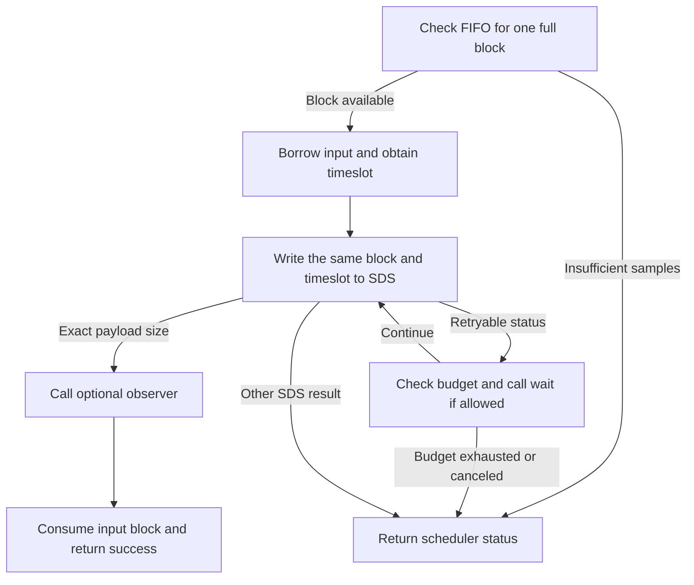

# SdsSink design

`SdsSink` records typed samples from a CMSIS Stream graph into an open Arm SDS stream. Each successful firing submits one fixed-size payload with an application-supplied timeslot and releases that block for reuse by the graph. SDS buffers the record for delivery through SDSIO.

## Architecture and interface

The Python node declares a single input `i`. Its sample type and count become the template arguments of `SdsSink<IN, inputSamples>`, which derives from `GenericSink`. The `params` constructor argument in the Python graph is a C++ expression for the application's `SdsSinkParams`. The node takes a const copy of those parameters when the scheduler constructs it. [Python declaration](../../nodes/SdsSink.py), [C++ node](../c/SdsSink.hpp), [endpoint parameters](../c/SdsEndpoint.hpp)

| Parameter | Contract |
| --- | --- |
| `stream` | Required SDS handle. The application opens it with `sdsModeWrite` before initializing the graph and keeps it open until the scheduler finishes. |
| `timeslot` and `context` | Required timestamp callback and its application-owned context. The node calls it once per firing with sufficient FIFO input, before the first SDS attempt. Every retry in that firing uses the same value. |
| `retry` | Sets the number of additional SDS attempts and supplies the wait callback and context. A nonzero limit requires a wait callback. The default gives one attempt. |
| `observer` | Optional callback and context. The node invokes it once after SDS accepts the whole record, while the input block is still available. |

`init()` requires a non-null handle, a timestamp callback, and a valid retry configuration. It returns `CG_INIT_FAILURE` when any check fails. The application is responsible for the handle's mode and lifetime. It can supply new parameters when it rebuilds the graph.

## Memory and ownership

The payload is `inputSamples * sizeof(IN)` bytes. The shared `recordBytes()` helper requires a trivially copyable sample type and a positive byte count representable as `int32_t`. The node passes the samples as raw bytes. The capture reader must agree on sample representation, byte order, and channel layout. SDS 3.1.0 adds an 8-byte header containing a 32-bit timeslot and a 32-bit payload length. The application's SDS stream buffer must fit the header and payload together.

| Storage | Owner and lifetime |
| --- | --- |
| Input FIFO and sample storage | The graph owns both. `getReadBuffer(0)` borrows the current input address while leaving the samples queued in a counted FIFO. The full-size `getReadBuffer()` advances the read position only after SDS accepts the record and the observer returns. |
| SDS circular buffer | The application supplies the backing array to `sdsOpen()` and keeps it valid through close. `sdsWrite()` copies the header and payload into the buffer. The SDS worker drains this storage independently of the graph's input block lifetime. |
| Node and per-call state | The node holds a FIFO reference through its base class, a copy of the parameter struct, and the last SDS return value. Each firing holds a local input pointer, timeslot, and retry loop state. Payload storage comes from the graph. |
| Callback data | The application owns callback contexts. The observer receives a `const` view of the input for the duration of the call. Copy or summarize the data within the callback before passing it to another thread. |

The node offers the same samples on each retry because the input position is held and the scheduler serializes graph firings. On a synchronous array edge, both access calls return the same address and schedule order governs when upstream code may reuse the storage. On a counted CMSIS Stream FIFO, the full-size read advances by `inputSamples`. Failure leaves the original block queued. [FIFO implementations](../../../thirdparty/CMSIS-Stream/platform/GenericNodes.hpp)

## Firing state machine

These states describe control flow within a firing. Each invocation starts with a fresh FIFO check and retry budget, and obtains a new timeslot if the required samples are ready.

`prepareForRunning()` returns `CG_SKIP_EXECUTION` when the input FIFO lacks a complete block and `CG_SUCCESS` otherwise. The synchronous scheduler can call `run()` directly, so `run()` repeats the check. On underflow it returns `CG_BUFFER_UNDERFLOW` before obtaining a timeslot or calling SDS.

| Transfer outcome | Result |
| --- | --- |
| `sdsWrite()` returns exactly the expected byte count | Call the optional observer, consume `inputSamples`, and return `CG_SUCCESS`. This confirms local SDS acceptance. Host delivery may still be pending. |
| `SDS_NO_SPACE` | Retry within the configured budget. SDS 3.1.0 reports this when the entire header and payload cannot fit. Return `CG_BUFFER_OVERFLOW` when the budget runs out on this status. |
| `SDS_ERROR` | Retry within the same budget. This generic status can include stream lock acquisition failure. Return `CG_BUFFER_ERROR` when the budget runs out on this status. |
| Wait callback returns `false` | Return `CG_STOP_SCHEDULER` without another SDS call. |
| Any other result, including `SDS_EOS`, a positive short write, or an I/O error | Return `CG_BUFFER_ERROR` immediately. Any SDS side effects persist after the firing ends. |

Transfer failures leave the block unconsumed and skip the observer. The timestamp callback has already run, so any side effects it performed remain in effect. If a caller later invokes `run()` again with that block still queued, the callback runs again and can supply a different timeslot. The in-firing retry policy preserves the original timeslot only for that invocation.

`lastSdsStatus()` starts at `SDS_OK` and records the raw result of the most recent SDS attempt, including a positive byte count. A FIFO skip or underflow before the first attempt of a firing leaves that value unchanged. Pair it with the scheduler return status when diagnosing the firing.

## Threading and timing

- The scheduler thread owns the node and input FIFO, and runs the timestamp callback, retry wait, and observer. Callback work and waits delay the rest of the graph. CMSIS Stream's asynchronous scheduling mode uses FIFO checks to skip unavailable firings on the scheduler thread.
- The SDS worker sends queued bytes from the circular buffer via SDSIO. SDS 3.1.0 wakes the worker when enough write data is queued and when closing a stream. Capture can therefore reach the host in batches. An I/O error may be reported through the SDS event callback after a successful firing. The application owns that error handling.
- Use one graph endpoint per SDS handle, and let the scheduler finish before closing it. `sdsClose()` asks the SDS worker to drain pending capture data and waits before completing the close. Application shutdown must account for close and transport errors even if every sink firing succeeded. After a failed firing the block remains in the graph FIFO. The close only drains records already queued in the SDS buffer.
- There are at most `1 + maxRetries` SDS calls in one firing. A wait callback can sleep or yield to let the SDS worker make space. Elapsed time depends on the duration of each SDS call and callback. The callback context and `lastSdsStatus()` are ordinary application and node state. Cross-thread access needs a synchronized handoff.

## DTLN AEC integration

The DTLN graph uses `SdsSink<float, 128>` to capture the mono output of `OverlapAdd` on `Dtln_Out`. One firing writes 512 payload bytes, representing one 8 ms hop at 16 kHz. The scheduler calls the sink last in each complete schedule cycle and uses a synchronous array edge backed by shared graph storage. The application supplies a 16 KiB, 32-byte-aligned SDS write buffer. [Graph definition](../../../projects/dtln_aec/app.py), [generated scheduler](../../../projects/dtln_aec/generated/scheduler_app.cpp), [buffer configuration](../../../projects/dtln_aec/demo.cpp)

The `recordTimeslot()` callback returns the latest timeslot published by the source on the same graph thread. This associates the capture record with its playback hop. The capture reader checks that every record has the expected payload length and an 8 ms timeslot step from zero. The retry policy allows 1500 additional attempts, waiting one kernel tick per retry callback and stopping if the controller or SDS I/O event callback signals cancellation. The demo controller joins the graph thread before closing the write handle, checks the close result and the atomic transport error flag, then reports the final session result. [SdsSource design](SdsSource.md), [capture reader](../../../projects/dtln_aec/test_data/sds_demo.py), [demo controller](../../../projects/dtln_aec/demo.cpp)

The output observer computes peaks from the borrowed output block and adds them to the waveform history. The graph thread offers a bounded snapshot to a separate LCD thread using thread flags and release/acquire synchronization. The display thread renders from the snapshot and can be slower than the graph because publication skips an update while a previous snapshot is pending. The SDS write buffer and the display snapshot have separate lifetimes. [Waveform display](../../../projects/dtln_aec/waveform_display.cpp)

## Verification

The host test checks underflow without an SDS call, stable timeslots across retries, retention of input after backpressure, short writes, I/O errors and cancellation, and consumption on success. It also checks observer data and reblocking in a generated source-to-sink graph. The host runner exercises synchronous and asynchronous schedules with an SDS test double. The DTLN validation notes cover device transport delivery and capture timing. [Host test](../../../tests/test_sds_nodes.cpp), [host runner](../../../tests/run_sds_tests.py), [DTLN validation notes](../../../projects/dtln_aec/VALIDATION.md)
