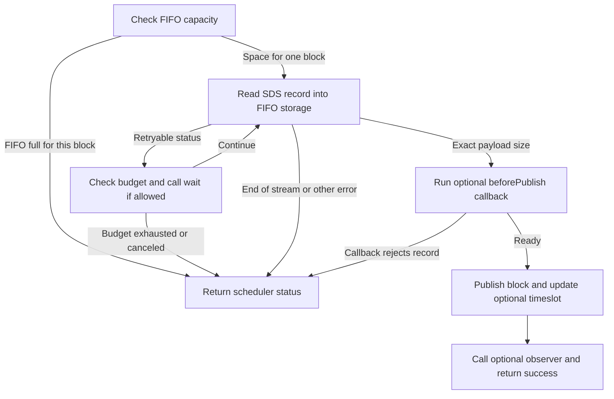

# SdsSource design

`SdsSource` plays records from an open Arm SDS stream into a CMSIS Stream graph. Each successful firing makes one fixed-size block of typed samples available to the graph and can report the record's timeslot to the application. The application owns the playback clock, stream lifecycle, and transport.

## Architecture and interface

The Python node declares a single output `o`. Its sample type and count become the template arguments of `SdsSource<OUT, outputSamples>`, which derives from `GenericSource`. The `params` constructor argument in the Python graph is a C++ expression for the application's `SdsSourceParams`. The node takes a const copy of those parameters when the scheduler constructs it. [Python declaration](../../nodes/SdsSource.py), [C++ node](../c/SdsSource.hpp), [endpoint parameters](../c/SdsEndpoint.hpp)

| Parameter | Contract |
| --- | --- |
| `stream` | Required SDS handle. The application opens it with `sdsModeRead` before initializing the graph and keeps it open until the scheduler finishes. |
| `timeslot` | Optional pointer to application-owned `uint32_t` storage. The node writes it after publishing the block. |
| `beforePublish` | Optional synchronous callback that receives the record's timeslot before publication. It can pace playback, validate the timestamp, or return a scheduler status. |
| `retry` | Sets the number of additional SDS attempts and supplies the wait callback and context. A nonzero limit requires a wait callback. The default gives one attempt. |
| `observer` | Optional callback and context. The node invokes it once after publishing a block and updating the optional timeslot output. |

`init()` requires a non-null handle and a valid retry configuration. It returns `CG_INIT_FAILURE` when either check fails. The application is responsible for opening the handle in the correct mode and rebuilding the node when the handle or callback configuration changes.

## Memory and ownership

The record payload is `outputSamples * sizeof(OUT)` bytes. The shared `recordBytes()` helper requires a trivially copyable sample type and a positive byte count representable as `int32_t`. The bytes must already match the graph's sample representation, byte order, and channel layout. SDS handles the record header separately. In SDS 3.1.0 it consists of a 32-bit timeslot and a 32-bit payload length, so the application must provide an SDS stream buffer that can hold at least the payload plus 8 bytes. Larger buffers accommodate transport jitter and batching.

| Storage | Owner and lifetime |
| --- | --- |
| Output FIFO and sample storage | The graph owns both. `getWriteBuffer(0)` obtains space for SDS to write without adding a block to the FIFO. The full-size `getWriteBuffer()` then advances the counted FIFO after a successful read and pacing callback. |
| SDS circular buffer | The application supplies the backing array to `sdsOpen()` and keeps it valid through close. The SDS worker refills the buffer via SDSIO and `sdsRead()` copies the payload directly to the graph's FIFO storage. |
| Node and per-call state | The node holds a FIFO reference through its base class, a copy of the parameter struct, and the last SDS return value. The timeslot and retry loop state are local to the firing. Payload storage comes from the graph. |
| Callback data | The application owns the callback contexts and the optional timeslot destination. An observer borrows a `const` view of the FIFO payload for the duration of the call. Copy or summarize the data within the callback before passing it to another thread. |

With a counted CMSIS Stream FIFO, requesting a write pointer can compact unread samples and adjust the internal indices while preserving occupancy. The zero-count access makes the destination contiguous. The later full-size request publishes those same bytes. A synchronous array edge supplies the same storage address on both calls and relies on schedule order for visibility. A failed read can alter bytes in the reserved storage without producing an output block. The scheduler must honor the returned status before running downstream nodes. [FIFO implementations](../../../thirdparty/CMSIS-Stream/platform/GenericNodes.hpp)

## Firing state machine

The states below follow the control flow of one invocation. Each call begins with a fresh FIFO check and retry budget.

`prepareForRunning()` returns `CG_SKIP_EXECUTION` if a full block would overflow the FIFO and `CG_SUCCESS` otherwise. This check considers graph capacity only. The synchronous scheduler can call `run()` directly, so `run()` checks capacity again and returns `CG_BUFFER_OVERFLOW` before calling SDS when space is insufficient.

| Transfer outcome | Result |
| --- | --- |
| `sdsRead()` returns exactly the expected byte count | Invoke `beforePublish` if supplied. On `CG_SUCCESS`, publish the samples, write the timeslot if configured, call the observer if configured, and return `CG_SUCCESS`. |
| `beforePublish` returns a status other than `CG_SUCCESS` | Return that status unchanged. SDS has already removed the record. The FIFO stays unpublished and the application timeslot and observer receive no update. A later firing reads the next record. |
| `SDS_NO_DATA` | Retry within the configured budget. SDS can retain a parsed header while waiting for the rest of the payload. Return `CG_BUFFER_UNDERFLOW` when the budget runs out on this status. |
| `SDS_ERROR` | Retry within the same budget. This generic status can include stream lock acquisition failure. Return `CG_BUFFER_ERROR` when the budget runs out on this status. |
| `SDS_EOS` | Return `CG_STOP_SCHEDULER` immediately. SDS can still return buffered complete records before reporting end of stream. |
| Wait callback returns `false` | Return `CG_STOP_SCHEDULER` without another SDS call. |
| Any other SDS result, including a short read | Return `CG_BUFFER_ERROR` immediately. A positive short read may already have consumed a record. In SDS 3.1.0 an oversized record returns `SDS_ERROR_PARAMETER`, with its header still pending inside SDS. Each firing requires an exact record size. |

`lastSdsStatus()` starts at `SDS_OK` and records the raw result of the most recent SDS attempt, including a positive byte count. FIFO skips and `beforePublish` outcomes leave it unchanged from that attempt. Read it alongside the scheduler status to distinguish FIFO capacity, SDS starvation, end of stream, and a callback stopping playback. The node returns stop immediately on EOS. If the graph reblocks samples, finish playback on a complete schedule cycle or handle residual samples at the application level.

## Threading and timing

- The scheduler thread owns the node and its FIFO. `run()`, the retry wait, the pacing callback, and the observer all execute on that thread. The callbacks run inline, so their execution and sleep time delay other firings in the same graph.
- The SDS worker manages prefetch from SDSIO into the circular buffer. During streaming, reads that free enough buffer space notify the worker to refill it. The graph and worker exchange data through SDS, while direct graph FIFO access stays on the scheduler thread. CMSIS Stream's asynchronous scheduling mode uses FIFO checks to skip unavailable firings on the scheduler thread.
- Use one graph endpoint per SDS handle. Keep the FIFO stable until the firing returns, including across callback waits. A callback that yields gives the SDS worker time to make progress. A bounded retry count means at most `1 + maxRetries` calls per firing. Elapsed time depends on the SDS calls and wait function, plus any playback pacing after a successful read.
- The timeslot destination and the last SDS status are ordinary variables. To report them across threads, have the scheduler copy the values into application-owned storage before destroying the node, then synchronize access to that storage. Callbacks that share state with other threads need their own synchronization.

## DTLN AEC integration

The DTLN graph uses `SdsSource<float, 256>` on the `Dtln_In` handle with a 16 KiB, 32-byte-aligned SDS read buffer. Each 1024-byte payload holds 128 interleaved microphone/reference pairs encoded as little-endian floats, for one 8 ms hop at 16 kHz. The split node deinterleaves the channels after publication. The scheduler executes one source and one sink firing per complete schedule cycle with synchronous array edges backed by shared graph storage. [Graph definition](../../../projects/dtln_aec/app.py), [record format](../../../projects/dtln_aec/test_data/sds_demo.py), [split node](../../../projects/dtln_aec/nodes_impl/DtlnSplitInput.hpp), [generated scheduler](../../../projects/dtln_aec/generated/scheduler_app.cpp)

The demo controller polls the host and moves from `SDS_STATE_CONNECTED` to `SDS_STATE_START` when playback is requested. It opens both handles, sets the endpoint parameters, marks `SDS_STATE_ACTIVE`, and starts a joinable graph thread. The graph thread runs the scheduler and frees its graph objects before reporting completion on the normal run path. The controller waits for completion and joins it before marking `SDS_STATE_STOP_REQ` and closing the handles. Successful closure leads to `SDS_STATE_STOP_DONE` and a cleared start flag. These states belong to the demo controller. [Demo controller](../../../projects/dtln_aec/demo.cpp), [graph thread entry and cleanup](../../../projects/dtln_aec/stream_init.cpp)

The pacing callback anchors the first record to the current kernel tick. For each later record it checks for an 8 ms timeslot increment using unsigned subtraction and waits until the next deadline with `osDelayUntil()` when early. If data arrives late, it reanchors to the current tick to maintain the hop spacing for subsequent firings. The retry policy allows 1500 additional attempts and delays one kernel tick between attempts if playback continues. The controller's atomic stop flag and the SDS I/O event's atomic error flag are checked by the wait and pacing callbacks. The source publishes the timeslot for the sink on the same graph thread. The waveform observer derives microphone peaks from the borrowed payload for the display pipeline. [Demo callbacks](../../../projects/dtln_aec/demo.cpp), [SdsSink design](SdsSink.md), [waveform display](../../../projects/dtln_aec/waveform_display.cpp)

## Verification

The host test checks source capacity skips, FIFO occupancy after short reads, FIFO compaction, timeslot publication, EOS, and a pacing callback that stops after an SDS read. An end-to-end test exercises retries, checks observer counts and payloads, and reblocks two source records into one sink record. The host runner generates synchronous and asynchronous schedules and uses an SDS test double with the pack header. [Host test](../../../tests/test_sds_nodes.cpp), [host runner](../../../tests/run_sds_tests.py)
