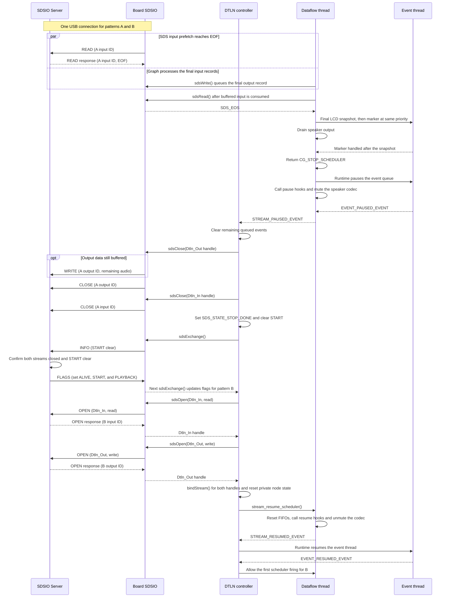

# DTLN SDS capture tests

SDS unit tests can send one input pattern after another in a single firmware
session and capture each pattern's output for comparison. Every transition
has two requirements.

1. **Finish the current pattern.** The end-of-stream signal marks the end of
   input. The application must finish processing any remaining data and flush
   the final output before closing the capture.
2. **Start the next pattern with a clean state.** Clear the graph's FIFOs,
   reset private node state, and clear any leftover events before processing
   the next pattern. This lets each test start from the same state.

## Why the DTLN capture is complete

Each synchronous scheduler iteration begins with `SdsSource` reading 128
microphone samples and 128 reference samples. `SdsSink` writes the 128
processed samples with the same timeslot before the next iteration. At
16 kHz, this yields one output record for each 8 ms input record. When the
source reports `SDS_EOS` at the start of the next iteration, the sink has
already handed every output record to SDS. The controller then closes
`Dtln_Out` to flush those records to the capture file. Waveform events run
on a separate thread and carry only LCD updates.
[Graph definition](../app.py) · [Generated schedule](../generated/scheduler_app.cpp#L96) · [Clip completion](#finish-the-clip-and-pause)

The test input includes 384 leading zero samples and enough trailing zeros
to complete the last hop and flush DTLN's 384-sample algorithmic delay. The
comparison skips the first 768 captured samples, which account for the
leading padding and the graph delay, and compares exactly the original clip
length against the float reference. The capture reader first requires the
exact padded record count, full payloads, and consecutive 8 ms timeslots.
The saved far-end, near-end, and double-talk captures contain 1,365, 1,376,
and 1,340 records respectively. A missing final record or a partial final
payload produces exit code `1`. [Fixture preparation and capture comparison](../test_data/sds_demo.py)

## Transition between test patterns

The automatic `test_demo.ps1` playlist runs three clips in one boot. It
configures one SDSIO playback step per pattern. The USB connection stays
open, and the graph, event queue, memory pools, and both runtime threads
stay allocated. The controller closes and reopens the two named data
streams for every step. [Test launcher](../test_demo.ps1) ·
[Playlist configuration](../test_data/datatest.sdsio.yml) ·
[Example playlist log](SDS_REPLAY.md#example-test-output)

### SDSIO handshake

SDSIO carries control messages and stream data over the same USB
connection. The firmware sends two fixed stream names in its `OPEN`
requests. `Dtln_In` carries microphone and reference samples from the host
to the board. `Dtln_Out` carries processed audio from the board to the
host. The playlist label selects the files behind those names. For label
`0`, the host plays `Dtln_In.0.sds` and records `Dtln_Out.0.p.sds`.
Label `1` uses the same stream names with files `Dtln_In.1.sds` and
`Dtln_Out.1.p.sds`.

| Direction | Message | Role in the transition |
| --- | --- | --- |
| Host → board | `FLAGS` | Sets `SDS_FLAG_START` and `SDS_FLAG_PLAYBACK` to request playback. The server also sends `SDS_FLAG_ALIVE` as a keepalive. |
| Board → host | `OPEN` | Opens `Dtln_In` for reading and then `Dtln_Out` for writing. The server returns a fresh SDSIO stream ID for each open. |
| Host → board | `READ` response with EOF | Signals the end of the input stream. After reading all buffered records, `SdsSource` receives `SDS_EOS` from `sdsRead()`. |
| Board → host | `CLOSE` | Closes `Dtln_Out` first, flushing the capture, and then `Dtln_In`. The server advances the playlist step once both are closed. |
| Board → host | `INFO` | Reports the current `sdsFlags` on the next `sdsExchange()`. The board clears `SDS_FLAG_START` after both closes succeed. The server waits for the streams to be closed and for `START` to be clear before requesting the next step. |

`SDS_STATE_START`, `SDS_STATE_ACTIVE`, `SDS_STATE_STOP_REQ`, and
`SDS_STATE_STOP_DONE` are local firmware states. The server uses the
`CLOSE` requests and the flags reported in `INFO` to coordinate the handoff.

An SDSIO ID identifies one open instance of a named stream. The server
assigns it in the `OPEN` response, and subsequent `READ`, `WRITE`, and
`CLOSE` messages use that ID. The board passes the `sdsId_t` handles
returned by `sdsOpen()` to `bindStream()` on the existing source and sink.
A board-side handle may reuse the same address after a close. The nodes
are rebound before the scheduler starts or resumes. [DTLN SDS controller](../demo.cpp#L22) ·
[Node binding](../stream_init.cpp#L84) · [SDS pack version](../dtln_aec.cproject.yml#L7)

SDSIO can also play multiple labels in a single step, with one open input
stream and EOF after the last label. Testing each label independently
within that stream would require an application-level boundary signal and
state reset between labels.

### Finish the clip and pause

1. Before returning `CG_STOP_SCHEDULER` to CMSIS Stream, DTLN posts the
   final LCD snapshot and a completion marker at the same event priority.
   It also sends any partial speaker block and drains the speaker. The LCD
   handler can still be running after the queue empties, so DTLN waits for
   the event thread to acknowledge the marker after that handler returns.
2. `CG_STOP_SCHEDULER` triggers the runtime's pause path. The runtime
   pauses event dispatch and calls `pause_scheduler_app()`, which invokes
   `ContextSwitchInterface::pause` on each identified node that implements
   it. The speaker hook mutes the WM8904 analogue headphone outputs after
   the final speaker block has drained. The runtime consumes
   `EVENT_PAUSED_EVENT` from the event thread
   before posting `STREAM_PAUSED_EVENT`. The controller waits for this
   final acknowledgement and clears the queue, discarding pending events
   and releasing their buffer references. A second pause request through
   `stream_pause_current_scheduler()` would wait for an event-thread
   acknowledgement that the runtime has already consumed.
3. The controller closes `Dtln_Out` followed by `Dtln_In` and acknowledges
   completion through the [SDSIO handshake](#sdsio-handshake). Once the
   output stream closes successfully, the capture is ready to compare.

[DTLN clip completion](../stream_init.cpp#L112) · [Runtime EOF pause](../../../thirdparty/CMSIS-Stream/platform/cmsis_rtos_runtime/stream_runtime_init.cpp#L185) · [SDS close handshake](../demo.cpp#L62)

### Reset state and resume

1. While both workers are paused, the controller reopens `Dtln_In` and
   `Dtln_Out` and clears playback timing and clip statistics. It calls
   `bindStream()` on the existing source and sink with the handles returned
   by `sdsOpen()`. The codec and I²S driver stay initialized between clips.
2. The controller calls `state_reset_intf->reset(node->obj)` on each
   identified node that exposes it. This clears recurrent state for both
   model stages, the microphone and reference sliding windows, overlap-add
   and waveform history, and the speaker's pending samples. It also
   refreshes the LCD and speaker status for the new clip.
3. `stream_resume_scheduler()` enables event posting and wakes the
   dataflow thread. The runtime calls `reset_fifos_scheduler_app(1)` to
   reset the FIFO positions and zero their backing storage. It then calls
   `resume_scheduler_app()`, which invokes `ContextSwitchInterface::resume`
   on identified nodes that implement it. The waveform capture node uses
   this hook to restart its display cadence, and the speaker hook unmutes
   the codec.
4. The dataflow thread waits on a semaphore before its first firing. The
   controller releases it after both workers acknowledge resume. This keeps
   an immediate EOF from pausing the graph during the resume handshake.

The generator gives identified nodes IDs and handles. `createStreamNode()`
exposes the C reset interface for C++ nodes that implement
`ResettableStreamState::resetState()` and the context-switch interface for
nodes that implement `ContextSwitch`. Reset hooks clear private node
memory. Resume hooks run with event posting enabled, so they can publish
events before execution starts. On the first clip, DTLN allocates the
runtime and constructs the graph, resets node and FIFO state, and invokes
the resume hooks before calling `stream_start_threads()`. Each node can
track its own first activation if it needs to distinguish it from resume.
[C interfaces](../../../common/stream/cstream_node.h) · [C++ adapter](../../../common/stream/IdentifiedNode.hpp) · [Runtime resume](../../../thirdparty/CMSIS-Stream/platform/cmsis_rtos_runtime/stream_runtime_init.cpp#L352)

The host scheduler test replays the three SDS input clips and an empty
clip. It checks that both workers are reused, the SDS handles are rebound,
and FIFO and processing state are reset at the clip boundary.
[Host scheduler test](../../../tests/test_dtln_stream.cpp)

### End the session or reset the board

At SDS session termination, cancellation, or a failed transition, DTLN
uses `stream_stop_threads()` to join both workers before freeing the
scheduler, event queue, and runtime memory. On this path the speaker is
muted and any queued samples drain under mute. If the final LCD snapshot or
marker fails to queue, or the marker times out, DTLN records an LCD error
and takes this teardown path. The sink has already handed the last audio
record to SDS in that case. [DTLN lifecycle](../stream_init.cpp#L211)

For an independent test that needs a fresh boot, use `T` or `t` in SDSIO
Server to set `SDS_FLAG_RESET`. Request it after both streams close and
`START` clears, then wait for the board to reconnect. A reset requested
during playback aborts the scheduler at a node boundary and can leave a
short capture. [Reset handling](../demo.cpp#L113)

## Adapting this test to another graph

Source EOF proves that all input records have been read. Output completion
depends on the schedule and the nodes' state. A graph that combines several
input hops into one output can reach EOF with a partial block queued. A graph
with filter tails or lookahead may still need extra input to emit its final
samples. An asynchronous branch can still be processing an event when the
source reaches EOF. Each of these cases needs a graph-specific completion
rule, such as padding to a full output block, flushing the processing tail,
or waiting for all required event handlers and any work they enqueue.
Close the recording after the sink accepts all expected output, then verify
its record count and timeslots against the graph's rate and alignment.

SDS knows about stream records and transport state. It has no way to
discover an application's FIFOs, private node state, pending events, or
peripheral queues. CMSIS Stream gives DTLN a place to pause execution, zero
FIFO storage, and reset each node so new fixtures can reuse the same
firmware. An application without those boundaries needs its own teardown and
reset code for in-place replay. If the application state is hard to
enumerate or reset reliably, a board reset provides a repeatable starting
point for each independent test.
