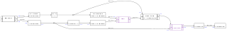

# How the DTLN-aec demo works

The DevKit-E8 receives a recorded microphone signal and its playback reference
from a PC over USB SDS. It runs two DTLN echo cancellation stages, sends the
processed audio back to the PC, and plays it through the board's Audio Out jack.
The LCD shows the microphone and echo-cancelled waveforms. [Demo setup](../README.md)

## From boot to the first clip

1. The board initializes its clocks, memory and Ethos NPU. The project's
   `app_prepare()` hook makes the model in OSPI flash accessible before the
   application thread starts. [Board startup](../../../board/DevKit-E8/main.c) ·
   [OSPI preparation](../ospi_startup.c)
2. `app_main()` starts by calling `dtln_runtime_init()`. The runtime checks
   the model's size and CRC before initializing ExecuTorch. The
   `ReleaseSRAM` build copies the model to SRAM0.
   During playback, `dtln_forward()` prepares the input tensors, executes
   the selected method, and copies out the result and next recurrent state.
   [Application entry](../app_main.cpp) · [Model runtime](../dtln_runtime.cpp)
3. `app_main()` checks and benchmarks `stage1` and `stage2` independently.
   It enters the streaming demo once both methods pass their startup checks.
   [Startup benchmarks](../benchmark.cpp)
4. `demo.cpp` initializes the display and USB SDS, then waits for the host's
   playback request. For each clip, it opens `Dtln_In` for replay and
   `Dtln_Out` for capture, ensures the speaker is initialized, and calls
   `dtln_stream_start()`. The demo services SDS while the graph runs and
   closes both streams when the clip finishes. [Replay controller](../demo.cpp)

## What happens every 8 ms

Each hop carries 128 samples per channel at 16 kHz. The input record
interleaves the microphone and reference samples. The two sliding buffers
maintain 512-sample windows so each DTLN stage has a longer frame to work with.

[Open the full-size graph to read the node and port labels](../generated/app.pdf)

`stage1` uses the magnitude spectra of both signals to estimate a mask.
The graph applies that mask to the complex microphone spectrum and runs
an inverse FFT. `stage2` refines the resulting time-domain frame using
the reference window. Overlap-add emits a 128-sample hop to `Dtln_Out`,
the speaker and waveform capture.

Each DTLN node retains its own recurrent state between hops. The speaker
node converts the output to PCM16 and combines two hops into a 256-sample
block. The board audio API manages the bounded stereo I²S queue, the WM8904
codec and muting. [DTLN node](../nodes_impl/DtlnMethod.hpp) ·
[Speaker node](../nodes_impl/SpeakerOutput.hpp) ·
[Board audio API](../../../board/DevKit-E8/audio_output.h)

Waveform capture takes peaks from the microphone and processed hops and
posts snapshots to the lower-priority event thread. The display node renders
each snapshot into the back framebuffer and presents it on the LCD.
[Waveform capture](../nodes_impl/WaveformCapture.hpp) ·
[Display node](../nodes_impl/WaveformDisplay.hpp)

## Where the graph comes from

`app.py` describes the nodes, their FIFO connections, and the event
connection from waveform capture to the LCD. It also supplies the sample
rate, hop and frame sizes, and CMSIS Stream thread and queue settings.
The generator writes the scheduler, node parameters and settings to
`generated/`. The firmware compiles these generated sources into the demo.
[Graph definition](../app.py) · [Repository generator](../../../common/stream_graph.py)

- `nodes/` describes DTLN-specific nodes for the generator, including the
  input splitter, model method, speaker and waveform nodes. These Python
  classes declare the ports, sample counts and constructor parameters.
  Their C++ counterparts implement what the nodes do at runtime.
  [Project node descriptions](../nodes/) · [Project node implementations](../nodes_impl/)
- `common/nodes/` supplies reusable descriptions for the SDS endpoints,
  sliding buffers, FFTs, spectral masking and overlap-add.
  [Shared node descriptions](../../../common/nodes/) ·
  [Shared node implementations](../../../common/nodes_impl/c/)
- `generated/scheduler_app.cpp` constructs the nodes and FIFOs, connects
  the event ports and runs the generated firing order.
  [Generated scheduler](../generated/scheduler_app.cpp)

Edit the graph or Python node descriptions and rerun `app.py` when the
topology or generated parameters change.
[Graph generation commands](../../../documentation/HOWTO.md#generate-the-stream-graph-and-build)

## How `app_params` connects the nodes to the board

There are two inputs to node construction. Python supplies values known
at generation time, such as the DTLN stage number. The running firmware
supplies pointers to the devices and statistics through `HardwareParams`.
The generated `AppParams` brings those inputs together for each node
instance that needs them.

1. `app.py` creates `DtlnMethod("stage1", 1)` and
   `DtlnMethod("stage2", 2)`. The Python node declares `needsHardware = True`
   and a `stage` parameter. The generator gives both instances the same
   `DtlnMethodParams` type with an `hw_` member and a `stage` member.
   [Python method node](../nodes/DtlnMethod.py)
2. `generated/app_params.h` declares `AppParams` with four named blocks
   (`speaker`, `stage1`, `stage2` and `lcd`). Its companion C file
   defines `appParams` with the two stage numbers and zero-initialized
   hardware pointers. [Parameter types](../generated/app_params.h) ·
   [Parameter defaults and setter](../generated/app_params.c)
3. `hardware_params.h` defines the application-owned `HardwareParams`
   structure. `hardware_params.cpp` supplies pointers to the shared
   `StreamStats` and LCD wrapper at startup and adds the speaker wrapper
   when playback is requested. [Hardware parameters](../hardware_params.h) ·
   [Hardware setup](../hardware_params.cpp)
4. When it creates the graph for the first clip, `stream_init.cpp` calls
   `app_params_set_hardware(&hardware)` to copy those pointers into the four
   generated `hw_` fields. It then calls
   `init_scheduler_app(eventQueue, &appParams)`. The generated scheduler
   passes each block to the matching C++ constructor, for example
   `params->stage1` to the first `DtlnMethod` instance. Both method nodes
   update the shared statistics through `hw_.stats` and select their own
   ExecuTorch method through `stage`. The speaker and LCD nodes take
   their device pointers from the same hardware configuration.
   [Graph startup](../stream_init.cpp) · [Node construction](../generated/scheduler_app.cpp)

SDS stream handles follow the lifetime of a clip. `demo.cpp` stores them in
`dtlnReplayParams` and `dtlnRecordParams`. The generated scheduler uses
those parameters when constructing the endpoints, and `stream_init.cpp`
rebinds the endpoints for each clip. [SDS controller](../demo.cpp) ·
[Endpoint binding](../stream_init.cpp)

## How the graph moves between clips

`stream_init.cpp` owns the execution lifecycle. It allocates the graph
and starts the dataflow and event workers for the first clip. On clean
end-of-file, it gives the final LCD snapshot and queued speaker audio
time to finish, then waits for the runtime to pause the graph. For the
next clip it reuses the workers and nodes, rebinds the SDS endpoints,
resets the node state and FIFOs, and resumes processing. This lets one
USB session replay several independent test clips.
[Stream lifecycle code](../stream_init.cpp) · [SDS replay and reset details](SDS_TESTS.md)
