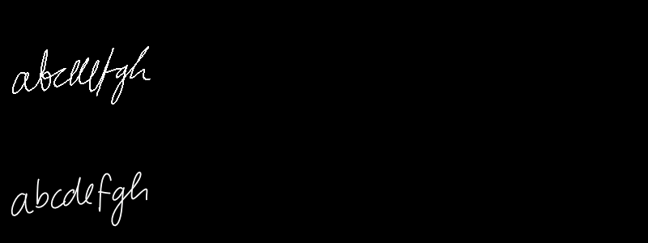
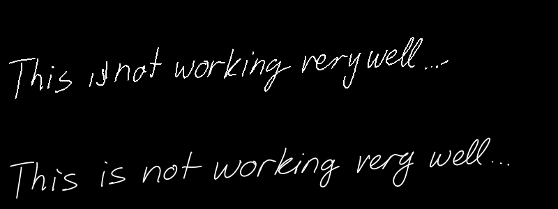
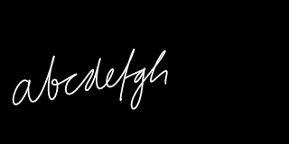
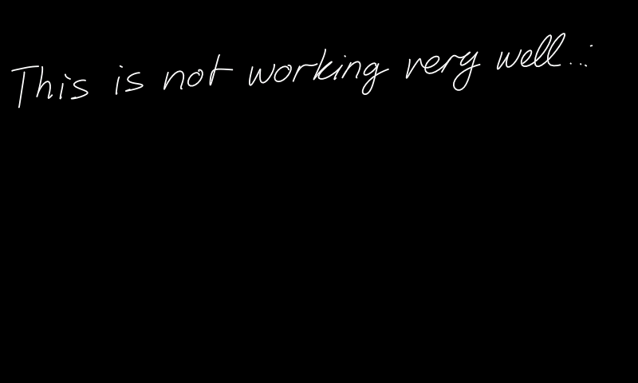

# Handwriting appearance investigation (2026-10-22)

The reported examples were `abcdefgh` (especially `fgh`) and
`This is not working very well ...` (the final three dots). The reference
website was [Calligrapher.ai](https://www.calligrapher.ai/), whose public page
provides legibility, stroke width and style controls. No claim of identical
weights, settings or output to the current website is made.

## Changes

- The UART demo now defaults to sampling bias **1.0**, instead of the fixed 0.5.
  `:bias 0..2` and `:seed 1..4294967295` apply to the next submitted sentence.
  The default seed remains 42. Queries without values report the settings;
  `:help` lists commands. Double a leading colon to enter literal text.
- Bias and seed are captured with the sentence, so commands do not alter an
  active trajectory. Settings survive replacement sentences until reset or
  changed, and are not saved across a board reset.
- The LCD retains subpixel coordinates and uses a round, antialiased 1.8-pixel
  pen. Gray RGB565 edge coverage replaces the former three-pixel integer brush.
  Max coverage at overlaps avoids bright joints or darkened edges. Damage
  tracking includes every changed edge pixel and retains two-buffer ownership.
- Early character/space wrapping no longer detaches finishing punctuation when
  it fits in the reserved right-hand margin. The policy covers the space before
  a punctuation-only suffix and the finishing steps attended by NUL. Hard screen
  bounds, three-line limits and extreme-coordinate checks remain enforced.

CPU sampling and rendering changed; the a16w8 graphs, weights and PTE did not.
`Engine::begin` retains its historical default bias 0.5 for existing fixtures and
benchmarks; the interactive controller explicitly passes the sentence's bias.
The graph still has five separate model nodes. Its sentence FIFO grew by eight
bytes; the three dataflow firings now use 128 bytes of FIFO storage.

## What the comparison establishes

[compare_quality.py](model/compare_quality.py) compiles the actual production
C++ recurrence/RNG/sampler into a host bridge and supplies either original float
dense layers or the saved pre-Vela quantized dense graphs through a callback.
This avoids comparing different random samplers. Host MSVC and board AC6 math,
and pre-Vela quantization versus NPU fixed-point requantization, still differ;
complete trajectories are not expected to match bit for bit.

The retained [metrics](model/quality_metrics.json) cover both sentences, biases
0.5 and 1.0, and seeds 42, 7 and 123: 24 runs, including 12 quantized runs.
Across these quantized trajectories there were **zero out-of-range input
activations**, and no float-reference dense outputs exceeded the corresponding
quantized output ranges. Per-method normalized RMS errors were **0.170–0.456%**
on identical inputs. These are numerical errors, not character-error rates.

Float generation also produced malformed endings and trailing strokes. One
float run (the longer sentence, seed 123, bias 1.0) reached its 1320-step limit.
All retained quantized runs completed normally. Thus quantization does change
the sampled trajectories, but these observations do not support attributing
the appearance problems entirely to quantization or clipping. No OCR accuracy
score or general handwriting-quality guarantee is claimed.

At seed 42, bias 1.0 gave clearer `fgh` and cleaner trailing dots in the host
quantized previews. Other seeds show that increasing bias is not uniformly
better. The comparison images below use the same LCD layout and pen code as
firmware: **old bias/brush/layout above, new bias/pen/layout below**. They are
host previews, not board photographs.





The upstream public
[Python demo](https://github.com/sjvasquez/handwriting-synthesis/blob/5f58984c3bc793bd8930bad7012cd2008d4a4a66/demo.py)
also supports style priming and applies denoising/alignment. The MCU demo remains
unprimed and draws online. Those are additional appearance differences; style
priming, whole-line alignment and denoising were not added here.

## Board validation

Release **b-12**, loaded with matching symbols by **d-13**, passed the unchanged
PTE CRC `cf5a91ed`, independent CPU equations and all five NPU fixtures, then
reached READY with bias 1.0 and seed 42. PTE SHA256:
`8991565f2c6ef468942789f458d6809f6879a1315c9610035b5e7a6f4390f3d3`.
AXF SHA256: `af2f07591ef2da2954de9b62152894d0a78915208fe76705200aae32ddae5d79`.

| Input (bias 1.0, seed 42) | Generated points | LCD lines | Elapsed RTOS ticks (1 kHz) |
| --- | ---: | ---: | ---: |
| abcdefgh | 248 | 1 | 8717 |
| This is not working very well ... | 725 | 1 | 25435 |

Changing bias/seed commands during the second generation preserved its
trajectory. Invalid `nan` bias and overflowing seed commands were rejected;
settings were restored to 1.0/42. At the readback, requests/acknowledgments/
inferences were all 975, generated/drawn were 973, and both sentences completed.
Application error, dropped events, deadline misses, clipped/outlier ink,
screen-full and step-limit counters were zero. The two rejections were deliberate.

Before the punctuation fix, the same 725-point NPU trajectory used two lines;
afterward it used one. The points were unchanged. A further board trial at bias
1.25 produced 755 points over two lines, so increasing the default further was
not justified by this example. No speed improvement is claimed.

[UART, counters and memory readback](model/quality_board_validation.json) retain
the evidence. MRAM LOAD usage is 519,056 bytes; SRAM0 remains 1,732,624 bytes;
RW_RAM is 158,572 bytes. Engine remains 13,888 bytes. Model/pool reservations are
unchanged. The comparison harness is host-only and is not linked into firmware.

These are direct framebuffer readbacks of the NPU-driven demo, not simulations
or camera photographs. The alphabet image was captured in b-8, which used the
same sampling/pen code; the final sentence image is b-12 after the wrap fix.





The actual sentence still has a stray elevated finishing mark. Sampling changes
improve readability but do not eliminate all model defects. User visual
acceptance remains separate from these numerical and framebuffer checks.

## Reproduce

From the repository root, using its configured Python environment and a host
C++ compiler:

```powershell
.venv/Scripts/python.exe projects/handwriting_synthesis/model/compare_quality.py --biases 0.5 1.0 --seeds 42 7 123
.venv/Scripts/python.exe projects/handwriting_synthesis/model/compare_quality.py --render-only
.venv/Scripts/python.exe tests/run_handwriting_tests.py
.venv/Scripts/python.exe -m unittest discover -s tests -p test_handwriting_graph.py
```

With MSVC, supply its compiler setup script using `--vcvars`; otherwise the
scripts default to `clang++`. `--sentences` and `--output` select inputs and the
output directory. Default output is `out/handwriting-quality/`: JSON metrics,
NPZ trajectories/attention, labeled SVG and PNG comparisons, and LCD previews.
The PNG rows in unwrapped comparisons follow the per-text JSON order; SVGs
include labels. No downloads, model regeneration or reprogramming are needed.

Host checks passed production editor commands, settings ownership and invalid
values, sampler scaling/reproducibility, NUL punctuation metadata, fractional
pen coverage/caps, viewport safety and all existing replacement/error paths.
Every partial-update frame matched a full-frame reference across 1952 saved
quantized points, with cache damage bounds and buffer immutability verified.
Both graph regressions passed with the updated 128-byte FIFO total.
