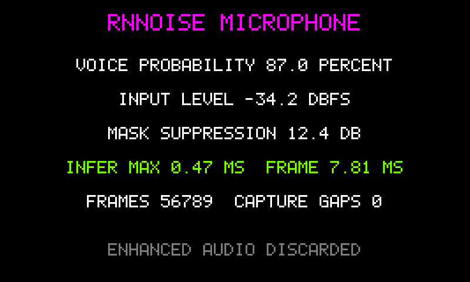

# RNNoise validation

Host DSP checks use the vendored ML-zoo Python frontend and its 160-frame
synthetic silence/tone/noise fixture. They validate implementation mechanics,
not perceptual speech quality or source TFLite equivalence.

| Host check | Result |
| --- | --- |
| Feature absolute error | maximum 0.019570768; mean 0.000145998 |
| Quantized features | 6 / 6,720 differ by one LSB; maximum one LSB |
| Synthesis, fixed 0.25 band mask | maximum normalized error 0.000019911; mean 0.000002004 |
| Reset | analysis features and synthesis bit-exact to a fresh instance |
| Silence | zero features and audio |
| Gain application | attenuated energy vs unity; zero mask leaves only the tiny silence bypass tail |
| LCD | production renderer with framebuffer guard words and maximum counters passes |
| Graph | generated from root and project folder, 5 firings, 10,864 FIFO bytes |

The feature error is smaller than the input quantization step (0.221500605),
but values near a quantization midpoint can round differently. The original
Python silence branch returns two values to a seven-value caller; the host test
repairs this tuple only in memory. No imported source file was modified.

Run `python tests/run_rnnoise_tests.py` in a C++17 compiler developer environment.
`--compiler` selects a compiler; `--executable` and `--lcd-executable` can reuse
already-built test executables. Raw host metrics are in
[evidence/host_dsp.json](evidence/host_dsp.json).

## Board validation

CMSIS MCP build and load target: `DevKit-E8@RNNoise_Release`; matching debug
symbols: `out/rnnoise/DevKit-E8/Release/rnnoise.axf`. CPU, AXI/NPU and system timer
are 400 MHz. The original whole-method benchmark remains in model/BENCHMARK.md;
application inference includes feature quantization and output unpacking.

Initial integration exposed `std::bad_alloc` in the frontend FFT's complex
vector allocation with the inherited 98,304-byte heap. The project reserves
262,144 bytes after the fix (confirmed by the build memory tool), plus a separate
32,768-byte application heap. Both project linker scripts carry the reservation.
No imported library or pack was edited.

The fixed application built and passed all four startup flags, then processed
813 live microphone frames with 813 synthesis calls and 390,240 discarded
samples, 81 completed LCD frames, and zero capture gaps, PDM drops/overflows,
audio deadline misses, LCD drops or LCD deadline misses. Maximum full-frame time
was 7.8070125 ms, analysis 4.92686 ms, inference 0.4655475 ms and synthesis
2.4001325 ms. These are independent maxima and should not be summed.

Whole-frame processing runs inline because the measured total fits the 10 ms
hop deadline. It excludes time waiting for the capture block. Capture and
one-hop overlap-add contribute 20 ms before processing and any bounded capture
queue delay. LCD publication is separately limited to 10 Hz.

The prior sustained build (b-19, load d-20) completed 3,005 frames / 1,442,400 discarded
samples and 301 LCD updates in an uninterrupted approximately 30-second run.
All four startup flags were one; pipeline error, capture gaps, PDM drops,
PDM overflows, audio deadline misses, LCD snapshot drops and LCD deadline misses
were all zero. Independent maxima were:

| Stage | Maximum ticks at 400 MHz | Maximum ms |
| --- | ---: | ---: |
| Analysis | 1,971,332 | 4.9283300 |
| Inference adapter | 188,097 | 0.4702425 |
| Synthesis | 960,167 | 2.4004175 |
| Complete frame | 3,122,051 | 7.8051275 |

The complete frame has 2.195 ms margin to the 10 ms deadline in this observed
microphone workload. It is not a worst-case execution-time proof for every
possible input. The [raw pre-halt snapshot](model/diagnostics/live_release.json) is the
performance evidence. Halting an audio target can itself cause a capture gap
and distort timing; debugger-induced recovery is recorded separately.

Final memory-tool result after reset optimization: approximately 814,952 bytes ROM and 2,220,916 bytes RAM
including reserved heaps/stacks, two 768,000-byte LCD framebuffers, two 65,536-byte
NPU pools, 131,072-byte RTX dynamic storage, and the 10,864-byte Stream FIFOs.
The optimized model's observed method/temp peaks remain 3,824 / 928 bytes; the
pool reservation intentionally retains headroom.

Intentional debugger-halt recovery was checked separately. After resuming, the
application advanced from 3,005 to 5,182 complete frames, with exactly one PDM
overflow, one capture discontinuity and one recurrent-state reset, no pipeline
error and no LCD snapshot drops. One 10.14 ms frame occurred while reconstructing
DSP state after that injected interruption; it is a recovery transient, outside
the uninterrupted real-time interval above. Frontend and synthesis reset their
histories on the same capture epoch. See
[evidence/debugger_gap_recovery.json](evidence/debugger_gap_recovery.json).
Further debugger halts may add the same expected counters. The target was
resumed after inspection and left running.

Shared graph/project/catalog regression checks: 31 unittest cases passed.

The recovery transient was then removed by retaining immutable FFT/window/DCT
tables and clearing only mutable histories. Host reset equivalence remained
bit-exact. The reset-optimized b-21/d-22 build ran 3,167 complete syntheses (3,168
inferences, paused during the next synthesis) and 317 LCD updates across three
intentional capture interruptions. All three PDM overflows produced exactly
three discontinuities and three recurrent resets, with zero pipeline error,
PDM drops, audio deadline misses, LCD snapshot drops or LCD deadline misses.
Maximum full-frame processing, including history resets, was **7.825190 ms**;
analysis 4.934320 ms, inference adapter 0.4673175 ms, synthesis 2.4082375 ms.
See [final reset validation](evidence/history_reset_live.json). The four startup
flags passed again; the target was resumed and left running with no breakpoints.

The reset-optimized build supersedes the recovery behavior of b-19; the earlier 3,005
frame uninterrupted snapshot remains evidence for ordinary operation. Final ROM
reservation is 814,952 bytes and RAM reservation remains 2,220,916 bytes.

## Final reviewed Release verification

After R1/R2 were cleared, CMSIS build **b-23** and fresh load/debug **d-24**
passed on `DevKit-E8@RNNoise_Release`, using matching
`out/rnnoise/DevKit-E8/Release/rnnoise.axf` symbols. From a fresh main breakpoint
with zero startup flag and zero synthesized frames, the target ran uninterrupted
until the first inspection pause: **4,687 complete frames** (46.87 seconds of
audio), **2,249,760 discarded samples**, and **469 LCD updates**. All four startup
flags passed; the fixture and 160-frame recurrent sequence matched the imported
host at zero LSB across all five outputs. Pipeline errors, capture gaps, PDM
drops/overflows, audio deadlines, LCD snapshot drops and LCD deadlines were zero.

Maximum complete-frame processing was **7.805175 ms**; independent maxima were
analysis 4.928290 ms, inference adapter 0.467995 ms and synthesis 2.4019775 ms at
400 MHz. Memory remains approximately 814,952 bytes ROM and 2,220,916 bytes
reserved RAM. These observed measurements complement the earlier explicit gap
recovery checks; they do not establish WCET or perceptual speech quality.

The [final reviewed run evidence](evidence/final_reviewed_release.json) contains
normalized values and full tool responses. The target was resumed after the
single final inspection; its last session status was running with no
breakpoints. Inspection itself can cause a capture interruption after resuming.
