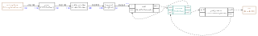

# YAMNet sound event classification

The Alif DevKit-E8 microphone feeds a 521-class sound-event classifier. The
landscape LCD displays the five leading labels and independent sigmoid scores.
Official TensorFlow YAMNet is reconstructed in PyTorch and deployed through
ExecuTorch and Vela. Its backbone is MobileNet V1-style; see the
[MobileNet V2 comparison](model/MOBILENET_COMPARISON.md) for the suggested reference.

The complete 3,601,536-byte PTE executes directly from OSPI at 100 MHz, without a
full-model SRAM copy. Float first/depthwise convolutions run on the CPU, while
14 automatically partitioned Ethos-U85 delegates run a16w8 pointwise/head work.
[The hardware investigation](model/HARDWARE_INVESTIGATION.md) preserves all
rejected quantization, convolution and storage experiments and their limitations.

## Build and run

```powershell
.venv/Scripts/python.exe scripts/create_ai_layer.py --project yamnet
.venv/Scripts/python.exe projects/yamnet/app.py
```

Use `DevKit-E8@YAMNet_ProgramModel` and the
[direct OSPI programming procedure](../../documentation/ospi-in-place-inference.md),
then build/load `DevKit-E8@YAMNet_Release` through CMSIS tools. The startup screen
remains visible for about 75 seconds while all 40 synthetic fixtures and ten
warmed forwards are checked. Capture begins after validation, with no manual gate.
Make a sound near the microphone; there is no audio playback.

A UART health line appears after the first displayed result and every ten results.
It reports capture/features, inference/display progress, skipped windows, deadline
and capture errors, stack space and inference pool peaks. Capture gaps fail the
pipeline rather than joining unrelated samples. Debugger pauses can cause such
gaps, so validate live capture with an uninterrupted fresh launch.

## Frontend and scheduling

The frontend uses mono 16 kHz PCM normalized by 32768, a periodic Hann window of
400 samples, a 160-sample hop, 512-point FFT magnitudes, 64 TensorFlow mel bands
from 125 to 7500 Hz, and natural log(mel + 0.001). There is no DC removal,
pre-emphasis, DCT or patch normalization. Patches contain 96 frames and advance
by 48 frames (480 ms).

An 80-sample lookahead preserves the exact windows 0..399, 160..559, etc., adding
5 ms to the first patch's 975 ms availability. Startup discards invalid frames.
Firmware compares the production window backend and log-mel outputs with
independent TensorFlow overlapping-window fixtures at tolerance 0.001.



The 10 ms real-time audio dataflow continues capture and feature extraction while
a lower-priority Stream event thread runs inference. Exactly one request remains
outstanding until acknowledgment. Node-owned history, latest-patch and immutable
in-flight buffers bound memory; intermediate pending patches are replaced and
counted. A single network node represents the complete PTE forward, including
its 14 delegates. It publishes the 521 raw sigmoid scores to a separate CPU
`YAMNetPostprocess` node, which validates finite scores in [0,1], selects the
top five and maps class indices to labels. This multilabel model already
includes sigmoid; no additional softmax or temporal smoothing is applied.
The postprocessor acknowledges score consumption before the network releases
the request. The LCD receives ordered, display-ready labels and scores; it
only formats text/percentages, draws and presents the frame. All three event
nodes run outside the audio dataflow.

The standalone median forward is **1482.160 ms**, including **60.735 ms** on the
NPU, at 400 MHz. With live capture, the forward takes about 1.55 seconds.
Displayed results arrive about every 1.58 seconds (roughly 0.63 results/s),
including presentation and request handoff. CPU spatial convolutions dominate. A pending
patch may be up to 480 ms old at submission; the result follows after inference.
Skipped windows can miss brief events. This application cannot classify every
480 ms patch in real time. [model/benchmark.yml](model/benchmark.yml) contains
raw timings, clocks and hashes; compiler estimates are separate.

## Validation and memory

All 40 board top classes matched saved PTQ outputs. Original Keras top-class
agreement was 39/40 (97.5%), and its top class was in the board's top five for all
40. These are synthetic numerical checks (38 independently seeded patterns and
two shared controls), not labelled AudioSet or real-world accuracy. Strict score
parity at 0.005 **fails separately**: maximum board/PTQ error is 0.064209 and
board/Keras error is 0.118445. Scores are approximate and are not a softmax
probability distribution.

Inference peaks are 829,016 bytes in the 1 MiB method pool and 298,752 bytes in
the 512 KiB temporary pool. Two 800x480 RGB565 framebuffers use 1,536,000 bytes.
The integrated application reserves about 2.97 MiB in SRAM0, plus DTCM state,
heap and stacks. See [LIVE_VALIDATION.md](LIVE_VALIDATION.md) for the final image
and the original uninterrupted live results. The explicit postprocessing node
is verified in [POSTPROCESSING_VALIDATION.md](POSTPROCESSING_VALIDATION.md).

## Reproduce

[model/CONVERSION.md](model/CONVERSION.md) contains reconstruction, calibration,
conversion and reproduction commands. The few copied upstream files and weights
are pinned in [model/upstream/provenance.json](model/upstream/provenance.json).
TensorFlow attribution and the [Apache-2.0 license](model/upstream/LICENSE) are
preserved. No GPL code, AudioSet media or separately licensed ontology is included.

```powershell
.venv/Scripts/python.exe -m unittest discover -s tests -p test_yamnet_graph.py
# cl requires its Developer Command Prompt; clang++ is also accepted.
.venv/Scripts/python.exe tests/run_yamnet_tests.py --compiler cl
.venv/Scripts/python.exe projects/yamnet/model/prepare_frontend_stream_test.py
```

The native tests exercise production window, publisher, network, CPU postprocessing
and LCD wrappers:
exact sample alignment, one request, immutable input, latest-patch selection after
acknowledgment, invalid-score rejection and ordered display-ready label routing.
The graph test forbids a direct network-to-LCD connection. `app.py` also runs from this project
directory. Shared `LogMel` is under `common/nodes` and `common/nodes_impl/c`;
YAMNet patching, event policy and UI are application-owned.
